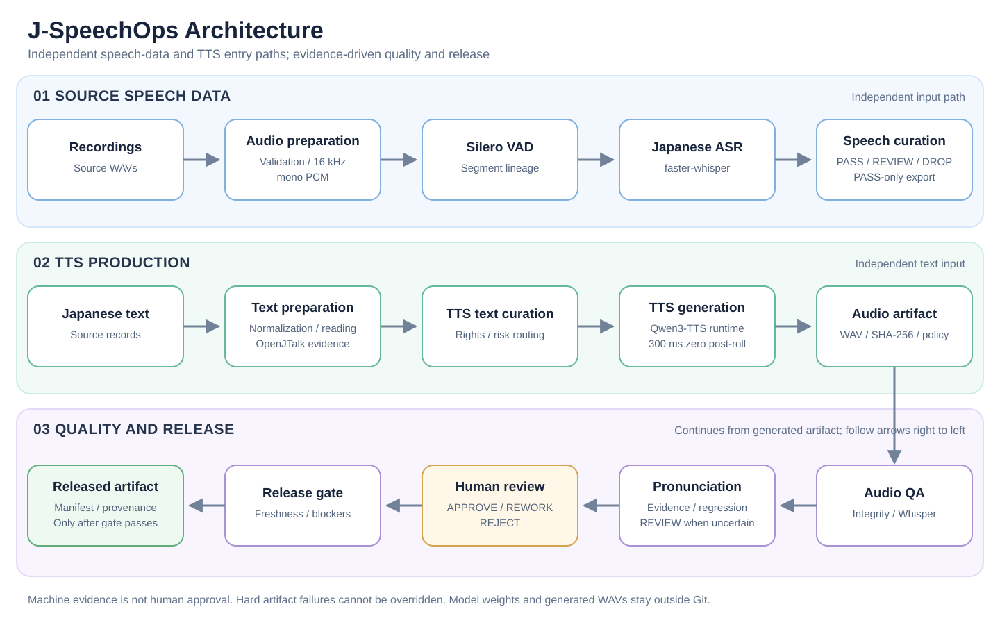

# J-SpeechOps

[English](README.md) | [简体中文](README.zh-CN.md)

[](https://github.com/liguozheng-ac/j-speechops/actions/workflows/test.yml)

日语语音数据质量控制与发布流程

## 项目概览

J-SpeechOps 构建了一套可审计的完整流程：从日语文本输入、语音生成，到自动质量检查、发音证据、人工审核和发布管理。

项目将生成、机器证据、人工判断和发布权限明确分离。生成了 WAV 并不代表音频合格；机器判定 `PASS` 不等于人工批准；人工批准也只对审核时对应的确切音频产物及证据上下文有效。

仓库还提供一条独立的语音数据流程，用于验证录音、切分语音、转写日语音频和筛选可用数据集。

这是面向受控批处理流程的生产导向原型，不是已部署服务，也不是模型训练平台。

## 快速开始

在 Windows 和 Python 3.14 环境下，克隆仓库并验证无需 GPU 或模型权重的 Core 包：

```powershell
git clone https://github.com/liguozheng-ac/j-speechops.git J-SpeechOps
cd J-SpeechOps
py -3.14 -m venv .venv
.\.venv\Scripts\python.exe -m pip install --upgrade pip
.\.venv\Scripts\python.exe -m pip install -e ".[dev]"
.\.venv\Scripts\python.exe -m pip check
.\.venv\Scripts\python.exe -m pytest -q
```

三个 GPU 集成测试均需显式启用，默认会跳过。Core 验证不包含 Whisper 或 Qwen3-TTS 模型下载。可选的模型运行方式见各阶段文档。

## 系统架构



系统边界和设计原则见[架构概览](docs/architecture_overview.md)。

## 主要能力

- 不可变的 Pydantic 数据契约与确定性的 JSONL 清单。
- 日语文本规范化，以及与具体模型解耦的读音准备。
- 对文本和生成音频进行明确的 `PASS`、`REVIEW`、`DROP` 分流。
- 与模型解耦的 TTS 任务规划，以及隔离的 GPU 运行环境。
- 可配置的零值音频尾部补静音，并记录带版本的来源信息。
- WAV 完整性检查与基于 SHA-256 的产物身份标识。
- 仅使用本地文件的日语 Whisper 回转转写证据。
- 发音风险证据与按逻辑样本进行的回归比较。
- 强制记录人工 `APPROVE`、`REWORK` 或 `REJECT` 决策。
- 检查证据时效性的发布门禁，且客观产物故障不可被人工覆盖。
- 串联生成、质量检查、证据、审核和策略的已发布音频清单。

## 工作流程

TTS 质量控制与发布路径分为明确的阶段：

1. 定义并导入规范的日语文本记录。
2. 规范化文本并准备预期读音。
3. 筛查权利、文字形式与发音风险。
4. 生成音频并应用配置的后处理策略。
5. 验证产物并收集内容一致性证据。
6. 构建发音与回归证据。
7. 将完整证据上下文提交给人工审核者。
8. 仅发布获得最新、符合策略的批准的产物。

模型文件、缓存、虚拟环境、WAV 输出和运行清单均通过仓库的忽略策略排除在 Git 之外。

### 示例流程

[合成发布流程记录](examples/release_flow/README.md)展示了一条 `TTSTextSample` 如何关联到 `GeneratedAudioArtifact`、`GeneratedAudioQAResult`、发音证据、`HumanReviewRecord` 和 `ReleasedAudioArtifact`。这些示例不含 WAV，也不包含真实人工审核。各项决策彼此独立：生成成功不代表质量检查 `PASS`；质量检查 `PASS` 不代表人工 `APPROVE`；即使已经 `APPROVE`，仍需通过当前有效的发布门禁决策，才能成为 `RELEASED`。

### 可选的模型运行

已验证的本地 GPU 环境使用 NVIDIA CUDA GPU。Qwen 使用项目内独立的 `.venv-tts` 环境；模型权重保存在仓库外、由使用者指定的目录。各阶段文档说明了按需启用的集成测试所需的环境变量、模型路径和预期输出。

## 技术决策

- 文本数据、合成运行、生成产物、质量检查证据、人工决策和发布记录具有独立生命周期。
- 实际生效的生成与后处理配置参与稳定运行身份的计算。
- 默认产物策略在尾部添加精确的 300 毫秒零值静音，不改变模型输出波形的原始前缀。
- 模型运行环境通过明确的子进程边界与 Core 环境隔离。
- 机器 `REVIEW` 将不确定性转交人工处理，并非永久拒绝发布。
- 缺失、损坏、静音、哈希不符、处理失败或来源信息不一致的产物仍是硬性阻断项。
- 不提供强制发布途径，也不伪造 MOS、自然度或发音评分。

详细记录见[架构决策](docs/architecture_decisions.md)。

## 当前限制

J-SpeechOps 目前不提供音调重音验证器、MOS 评估器、自动自然度评分、审核者身份认证、图形化审核界面或生产部署层。ASR 与读音提供器只是证据来源，并非语音学上的标准答案。

当前 GPU 基线适用于受控批处理流程，不能证明实时对话延迟，也不能保证跨机器生成字节级一致的音频。

## 未来工作

未来可以增加更强的音素证据、审核者身份集成、发布打包、更多模型适配器和部署工具。新增能力应继续遵守现有的证据、来源追溯与人工批准边界。

## 文档

- [架构概览](docs/architecture_overview.md)
- [架构决策](docs/architecture_decisions.md)
- [数据契约](docs/data_schema.md)
- [日语规范化策略](docs/japanese_normalization_policy.md)
- [日语读音策略](docs/japanese_reading_policy.md)
- [TTS 文本筛选](docs/stage7_tts_text_curation.md)
- [Stage 8 TTS 生成](docs/stage8_tts_generation.md)
- [Stage 8 音频尾部补静音策略](docs/stage8_post_roll_policy.md)
- [Stage 9 生成音频质量检查](docs/stage9_generated_audio_content_qa.md)
- [Stage 10A 发音回归](docs/stage10a_pronunciation_regression.md)
- [Stage 10B 人工审核与发布](docs/stage10b_human_review_release.md)
- [诊断工具](tools/diagnostics/README.md)

## 许可证

Copyright 2026 Guozheng Li.

本项目采用 Apache License, Version 2.0 许可。详情见 [LICENSE](LICENSE)。
